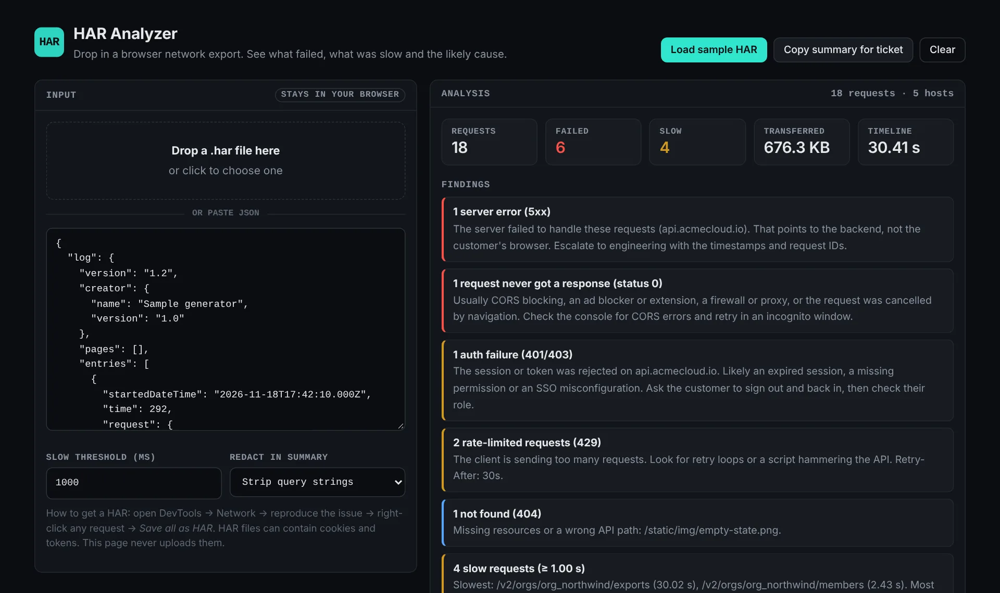

# HAR Analyzer

Drop in a browser HAR export and see what failed, what was slow and the likely cause, without scrolling through 900 requests.

**Live demo → https://rajprasad19.github.io/har-analyzer/** (click **Load sample** to try it without real data)

## Features
- **Findings in plain English.** 5xx errors, status-0 requests (CORS, extensions, blocked), 401/403 auth failures, 429 rate limits with Retry-After, 404s, slow calls, and whether the slowness is server wait (TTFB) or the network
- **Redirect chains and loops.** Follows every 3xx through its `Location` / `redirectURL` and flags loops (the same URL coming back around, like an SSO login that bounces forever) and chains of 3+ hops. Each one is drawn hop by hop with status codes, and clicking a hop opens its headers
- **Per-host breakdown.** Every host with its request count, errors, error rate and total time, worst first, so you can tell at a glance whether it's your API, a CDN or a third-party script that's failing. Click a host to filter the request table to it
- **Filterable request table** with a waterfall, plus a detail view for headers, timing breakdown and response body. Cookies and auth headers are masked
- **Search requests** by URL, method or status as you type. It stacks with the type chips, so `errors` + `invoices` finds the failing billing call in a second. Status classes like `5xx` work, and press `/` to jump to the box or `Esc` to clear it
- **Copy summary for ticket** writes a Markdown summary with failed requests, timestamps and request IDs, ready for a Jira or Zendesk escalation
- **Download CSV** of every failed and slow request: the finding (5xx, auth, 429, status 0, slow…), status, method, URL, time, server wait, request ID and start time, in the order they happened. Attach it to the ticket so engineering can match rows against their logs. It follows the same redaction setting as the summary, and cells that a spreadsheet would treat as formulas are neutralised
- **Private by design.** No backend; the file never leaves the browser

## How it works
1. Parses `log.entries` from the HAR (spec 1.2, as exported by Chrome, Firefox and Safari).
2. Buckets each request by status class, resource type and timing (`blocked`, `dns`, `connect`, `ssl`, `send`, `wait`, `receive`).
3. Runs rules over the buckets to produce findings, ranked by severity.

## Run locally
It's a single static file with no build step and no dependencies. Open `index.html` in a browser.

## Why I built it
I've spent years in support and support engineering roles (Wizards of the Coast, Dwelo), and these are the checks I kept doing by hand on escalations. This turns them into a two-second paste.

---
Built by [Raj Prasad](https://github.com/rajprasad19) · [LinkedIn](https://www.linkedin.com/in/raj-prasad-3a2669140/)
